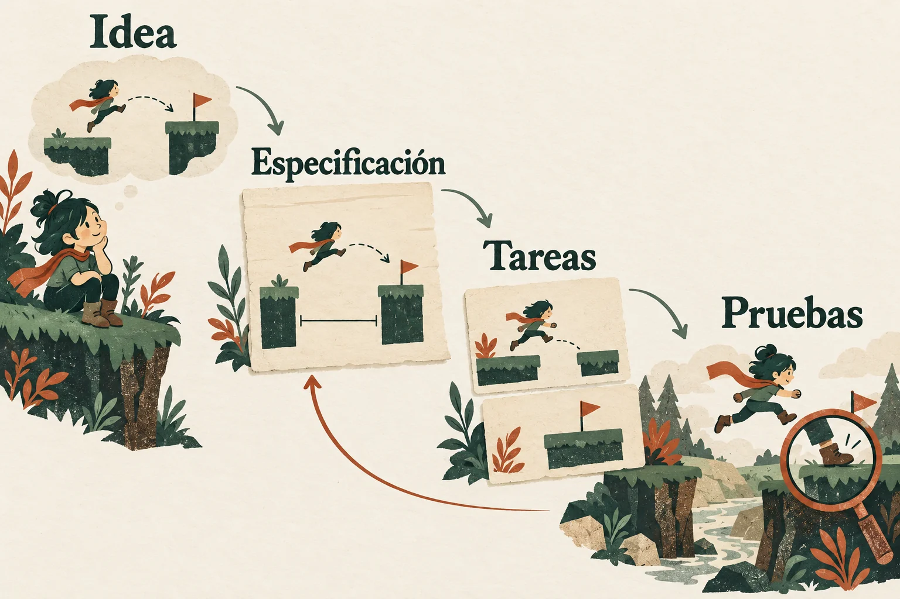
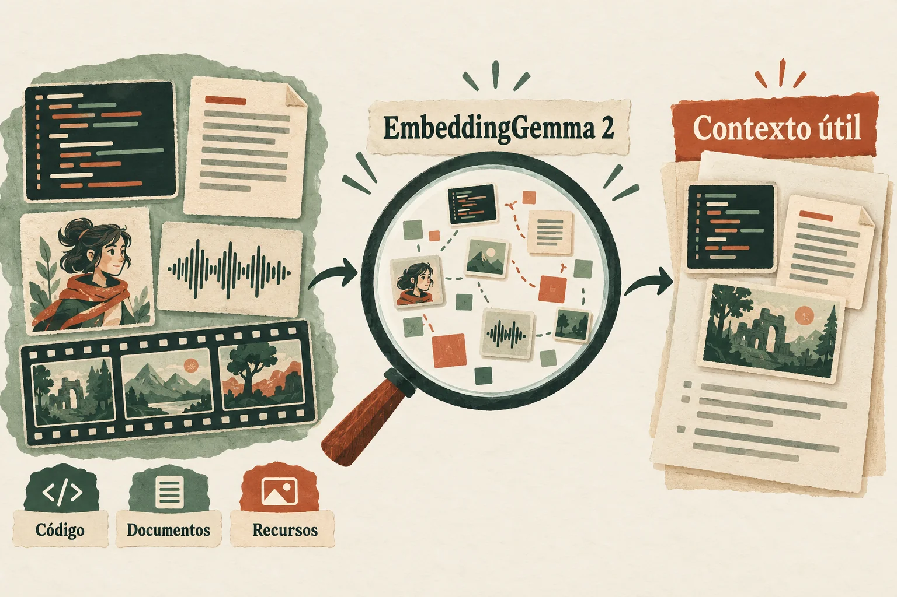

# Cómo trabaja tu IA con la biblioteca

Estas ilustraciones explican el procedimiento. Las fuentes, las decisiones y las pruebas
siguen disponibles como texto: el método sirve para cualquier género y se adapta al
proyecto, al equipo y a la plataforma.

## 1. Conocimiento, método y proyecto

**La biblioteca aporta fuentes.** El agente puede consultar fundamentos, recetas,
herramientas, arte, sonido, producción y la API de la versión aplicable. El índice de
símbolos se deriva del runtime seleccionado; cuando falta, la skill ofrece una vía
al manual oficial y declara qué no pudo comprobar.

**La skill dirige el trabajo.** Primero recupera el estado y las reglas del proyecto.
Después selecciona las referencias necesarias, concreta requisitos, verifica símbolos
y exige evidencia del resultado. Su paquete incluye referencias locales: una consulta
no necesita cargar toda la biblioteca en el contexto del modelo.

**Tu juego reúne las decisiones.** Género, controles, identidad visual, arquitectura,
presupuestos y criterios de aceptación pertenecen al proyecto. El método ayuda a
implementarlos; la calidad se evalúa en el juego y en sus plataformas de destino.

[Ver la skill](./_indice/skills/gamemaker-biblioteca/SKILL.md) ·
[Elegir cómo consultar](./_indice/skills/gamemaker-biblioteca/references/rutas-de-consulta.md) ·
[Instalar](INSTALACION.md)

## 2. Una idea se convierte en trabajo comprobable

Por ejemplo, «el personaje puede saltar» deja abiertas la altura, el alcance, los controles
y la condición de aterrizaje. Una especificación acuerda esos valores y describe qué se
observará para aceptarlos. Si ya existen requisitos y tareas, el agente los reutiliza.

Las tareas entregan partes jugables: una puede conectar entrada, movimiento, colisión
y una escena de prueba. Cada tarea conserva sus dependencias, los archivos que puede
modificar y una condición de aceptación. La compilación detecta ciertos errores;
la ejecución comprueba el comportamiento, y la revisión visual evalúa su presentación.

El ciclo completo es **contexto → requisitos → especificación → tareas → implementación
y pruebas → integración → revisión → aceptación**. Las skills de método se seleccionan
según la fase; las especializadas aportan diseño, movimiento, recursos o diagnóstico
cuando hacen falta. Si otra skill no está instalada, se declara esa disponibilidad
y se sigue el contrato documentado.

La evidencia identifica revisión y cambios locales, runtime, target, configuración
y escenario. Un resultado anterior conserva valor histórico; para aceptar cambios
posteriores hay que comprobar qué pruebas siguen siendo aplicables. Un fallo conduce
a diagnóstico y corrección, con una nueva ejecución cuando corresponda.

[Método y router de skills](<13 - Diseño y producción de videojuegos/29 - Desarrollo con IA - orquestación, crítica y evidencia.md>) ·
[De un encargo a una especificación](<13 - Diseño y producción de videojuegos/28 - De hazme un juego a una especificación - el protocolo de elicitación del agente.md>) ·
[Pruebas y entrega](./_indice/skills/gamemaker-biblioteca/references/qa-y-entrega.md)

## 3. Encontrar contexto sin leerlo todo

Un símbolo conocido se busca en el índice o en el manual. Una frase literal se busca
con `rg` o `tg`. Cuando se conoce el comportamiento pero no su nombre (por ejemplo,
«dónde se impide actuar durante una pausa»), **EmbeddingGemma 2** puede recuperar
candidatos por significado y relacionar código, documentos y recursos multimodales.

El agente acota el proyecto y la modalidad, abre las fuentes candidatas y comprueba sus
límites antes de usarlas. Conserva ruta, ubicación y huella para poder volver al origen.
La similitud ayuda a encontrar duplicados o clasificar; cada decisión se comprueba y
no autoriza borrar archivos automáticamente.

Esta herramienta es **opcional**. Sin ella se usa el mapa, los catálogos y la búsqueda
literal. La selección de contexto pretende reducir lecturas irrelevantes; el ahorro
se mide con tokens reales y con la corrección de la tarea, sin porcentajes prometidos.
Un modelo de embeddings local tampoco determina dónde procesa el contexto el agente:
hay que comprobar la ruta de datos y enviar solo contenido autorizado.

Indexar puede escribir en disco o cargar el modelo. Se respetan los límites de recursos
y las pausas del proyecto. Los embeddings que utiliza el agente no tienen que entrar
en el ejecutable del juego; integrarlos como función del producto requiere su propio
contrato y evaluación de recuperación.

[Búsqueda multimodal y evaluación](<12 - Utilidades e integraciones/11 - Búsqueda multimodal con EmbeddingGemma 2 - contexto y recursos para agentes.md>) ·
[Referencia breve de contexto](./_indice/skills/gamemaker-biblioteca/references/contexto-y-recursos.md)

Las tres imágenes son ilustraciones conceptuales generadas con IA.
[Procedencia y licencia](assets/readme/README.md) · [Volver al inicio](README.md)
