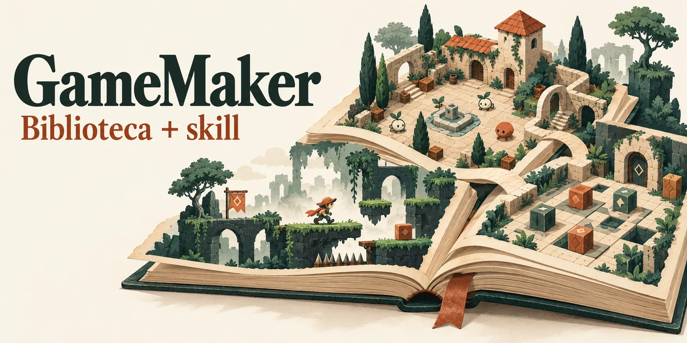
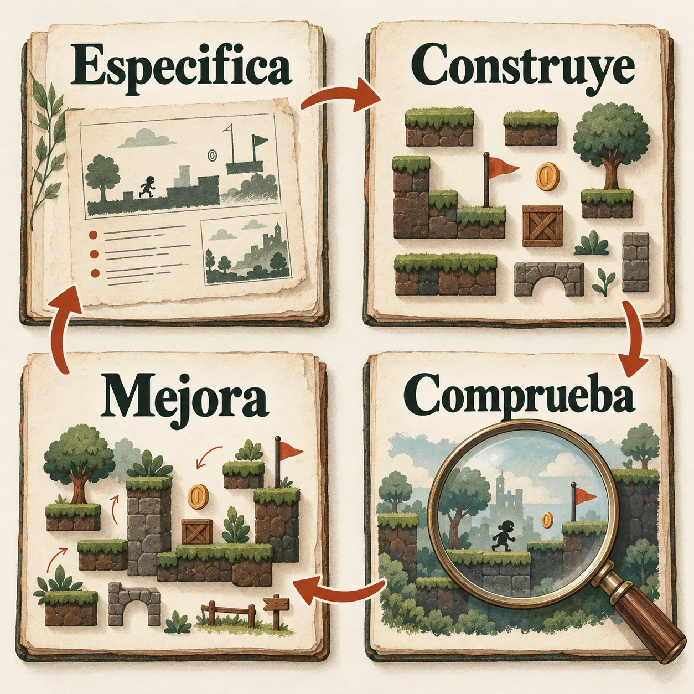

<p align="center">
  
</p>

# Tu IA. Un método para crear juegos con GameMaker.

Una **biblioteca en español** para aprender y consultar GML, y una **skill** que da a tu agente de IA un método de trabajo: especificar, construir, comprobar y mejorar.

**[Instalar la skill](INSTALACION.md)** · **[Explorar la biblioteca](GUIA.md)** · **[Aprender desde cero](RUTA.md)**

## Empieza aquí

Necesitas **Git, Python 3.10 o posterior y Bash**. En Windows, usa Git Bash. Puedes instalar la skill antes de instalar GameMaker.

```bash
git clone https://github.com/SwonDev/gamemaker-biblioteca.git
cd gamemaker-biblioteca
python3 -m venv .venv
source .venv/bin/activate
python -m pip install -r _indice/requirements.txt
./instalar.sh
```

En Git Bash, activa el entorno con `source .venv/Scripts/activate`; si tu equipo usa `python` en lugar de `python3`, usa ese nombre. [Instalación paso a paso y ayuda](INSTALACION.md).

Abre tu agente en el proyecto de GameMaker y pídele, por ejemplo:

> Usa gamemaker-biblioteca. Quiero un juego de plataformas 2D para ordenador. Ayúdame a definirlo, escribe la especificación y construye una primera parte jugable con pruebas y revisión.

El instalador conserva las copias anteriores. Para comprobar firmas de GML contra **tu runtime**, instala GameMaker y genera los índices: [activar las herramientas](INSTALACION.md#activar-las-herramientas-de-gml).

## Biblioteca + skill

**La biblioteca es el conocimiento.** Fundamentos, recetas por género, arte, sonido, arquitectura, combate, IA, accesibilidad, pruebas y publicación. Puedes leerla sin usar ninguna IA.

**La skill es la forma de trabajar.** Tu agente consulta las fuentes, concreta el encargo, divide el trabajo, verifica el código y revisa el resultado. Funciona como una capa de método sobre tu CLI y el modelo que tú elijas.

Compatible con agentes que leen **Agent Skills** o **AGENTS.md**, incluidos Claude Code, Codex y OpenCode. [Destinos y límites de compatibilidad](INSTALACION.md#qué-cli-de-ia-están-soportados) · [Ver la skill](./_indice/skills/gamemaker-biblioteca/SKILL.md).

## Del encargo al juego comprobado

<p align="center">
  
</p>

El método cubre el desarrollo guiado por especificación (*spec-driven*), tareas que entregan una parte jugable, selección de skills, revisión independiente y pruebas ligadas a la versión actual. **Compilar es una puerta; jugar, medir y revisar el acabado son otras.**

Para aspirar a calidad AAA, exige criterios de arte, sonido, accesibilidad, rendimiento y juego completo. La skill guía ese trabajo; la calidad final se demuestra en cada proyecto y plataforma.

**[Método completo de desarrollo con IA](<13 - Diseño y producción de videojuegos/29 - Desarrollo con IA - orquestación, crítica y evidencia.md>)**

## Encuentra lo que necesitas

- **Quiero aprender:** [ruta por nivel](RUTA.md) y [fundamentos](<01 - Fundamentos>).
- **Quiero crear un juego:** [recetas por género](<04 - Recetas por género>) y [diseño y producción](<13 - Diseño y producción de videojuegos/_INDICE-DISENO.md>).
- **Quiero buscar una función o resolver un error:** [cómo buscar](./_indice/COMO-BUSCAR.md) y [operar GameMaker con gm-cli](<12 - Utilidades e integraciones/09 - Manual del agente de IA - operar GameMaker con gm-cli.md>).
- **Quiero ahorrar contexto:** [EmbeddingGemma 2](<12 - Utilidades e integraciones/11 - Búsqueda multimodal con EmbeddingGemma 2 - contexto y recursos para agentes.md>) encuentra y clasifica código, documentos, imágenes, audio y vídeo por significado. Es opcional; conserva una vía de búsqueda literal y mide el ahorro real.

## Conocimiento que se puede comprobar

Los símbolos se extraen del runtime instalado; el índice avisa si cambia. Un comando verifica enlaces, ejemplos, descubrimiento e integridad de la skill: `python _indice/actualizar.py`. [Pruebas y alcance de esta actualización](./_indice/auditorias/r21-publicacion.md).

**Referencia documental:** GameMaker LTS 2026.0. El manual oficial y el código de terceros se reconstruyen aparte, con sus licencias. La instalación de la skill no instala GameMaker, EmbeddingGemma ni cambia tu modelo. [Qué se distribuye](PUBLICAR.md).

[Contribuir](CONTRIBUTING.md) · [Informar de un problema](https://github.com/SwonDev/gamemaker-biblioteca/issues) · [Licencias](LICENSE)

Herramientas y código propio: **MIT**. Documentación e ilustraciones propias: **CC BY-SA 4.0**. Proyecto independiente de YoYo Games. Las imágenes son ilustraciones generadas con IA; [procedencia](assets/readme/README.md).
