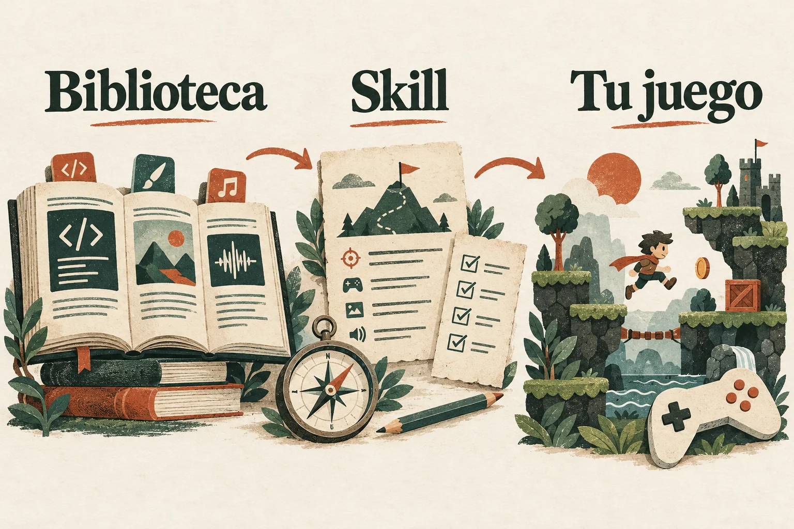

<p align="center">
  
</p>

# Tu IA. Un método para crear juegos con GameMaker.

Una **biblioteca en español** para aprender y consultar GML, y una **skill** que da a tu agente de IA un método de trabajo: especificar, construir, comprobar y mejorar.

**[Instalar la skill](INSTALACION.md)** · **[Explorar la biblioteca](GUIA.md)** · **[Aprender desde cero](RUTA.md)**

## Empieza aquí

Instala la skill con el [instalador habitual de Agent Skills](https://github.com/vercel-labs/skills):

```sh
npx skills add SwonDev/gamemaker-biblioteca --skill gamemaker-biblioteca -g
```

Con pnpm: `pnpm dlx skills add SwonDev/gamemaker-biblioteca --skill gamemaker-biblioteca -g`.
`-g` la deja disponible en todos tus proyectos; puedes elegir los agentes de destino.
Se instalan la skill y sus referencias. Para disponer también de los documentos, buscadores
y validadores locales, instala la **biblioteca completa** con **Python 3.10 o posterior**:

**macOS y Linux:**

```sh
python3 -c "import hashlib,urllib.request; b=urllib.request.urlopen('https://raw.githubusercontent.com/SwonDev/gamemaker-biblioteca/r50/instalar-remoto.py').read(); exec(compile(b,'instalar-remoto.py','exec')) if hashlib.sha256(b).hexdigest()=='177009c52b83e0d39039ab490061d9d347ece57671711642e7393c9f2178087f' else exit('Descarga no válida')"
```

**Windows (PowerShell):** usa el mismo comando cambiando `python3` por `py -3`.
[Otras formas de instalar, actualizar o elegir agentes](INSTALACION.md).

Abre tu agente en la carpeta del juego y escribe con normalidad:

> Quiero hacer un juego con GameMaker. Será de plataformas 2D para ordenador.

La skill selecciona las referencias necesarias y consulta un asesor al definir el juego o tomar decisiones costosas. Una duda puntual carga solo su ruta. El instalador de la biblioteca completa registra su ubicación, prepara los destinos compatibles y conserva las copias anteriores. Para ejecutar y verificar juegos necesitas GameMaker y su runtime; [activar las herramientas](INSTALACION.md#activar-las-herramientas-de-gml).

##  Biblioteca + skill

**La biblioteca es el conocimiento.** Fundamentos, recetas por género, arte, sonido, arquitectura, combate, IA, accesibilidad, pruebas y publicación. Puedes leerla sin usar ninguna IA.

**La skill es la forma de trabajar.** Tu agente consulta las fuentes, concreta el encargo, divide el trabajo, verifica el código y revisa el resultado. Funciona como una capa de método sobre tu CLI y el modelo que tú elijas.



**[Cómo funciona: guía visual del método](<Método visual.md>)**

Compatible con agentes que leen **Agent Skills** o **AGENTS.md**: Claude Code, Codex, OpenCode, Pi, OMP, MiniMax Code, DeepSeek Harness (`dsh`), Hermes Agent y gentle-shell, entre otros. Puedes elegir un destino con `python3 instalar.py --harness dsh`. [Destinos, pruebas y límites](INSTALACION.md#qué-cli-de-ia-están-soportados) · [Ver la skill](./_indice/skills/gamemaker-biblioteca/SKILL.md).

##  Del encargo al juego comprobado

<p align="center">
  
</p>

El método cubre el desarrollo guiado por especificación (*spec-driven*), tareas que entregan una parte jugable, selección de skills, revisión independiente y pruebas ligadas a la versión actual. **Compilar es una puerta; jugar, medir y revisar el acabado son otras.**

Para aspirar a calidad AAA, exige criterios de arte, sonido, accesibilidad, rendimiento y juego completo. La skill guía ese trabajo; la calidad final se demuestra en cada proyecto y plataforma.

**[Método completo de desarrollo con IA](<13 - Diseño y producción de videojuegos/29 - Desarrollo con IA - orquestación, crítica y evidencia.md>)**

[Especificación viva y mejora del método](<13 - Diseño y producción de videojuegos/30 - Especificación viva y mejora del método.md>)
conecta cambios de requisito, tareas, pruebas y evidencia; incluye promoción de aprendizajes
y evaluación de la propia skill, con aportes contrastados de Matt, Gentle AI y ECC.

##  Encuentra lo que necesitas

- **Quiero aprender:** [ruta por nivel](RUTA.md) y [fundamentos](<01 - Fundamentos>).
- **Quiero crear un juego:** [recetas por género](<04 - Recetas por género>) y [diseño y producción](<13 - Diseño y producción de videojuegos/_INDICE-DISENO.md>).
- **Quiero buscar una función o resolver un error:** [cómo buscar](./_indice/COMO-BUSCAR.md) y [operar GameMaker con gm-cli](<12 - Utilidades e integraciones/09 - Manual del agente de IA - operar GameMaker con gm-cli.md>).
- **Quiero ahorrar contexto:** [EmbeddingGemma 2](<12 - Utilidades e integraciones/11 - Búsqueda multimodal con EmbeddingGemma 2 - contexto y recursos para agentes.md>) encuentra y clasifica código, documentos, imágenes, audio y vídeo por significado. Es opcional; conserva una vía de búsqueda literal y mide el ahorro real.

## Conocimiento que se puede comprobar

Los símbolos se extraen del runtime seleccionado; compara su versión con la del proyecto. Un comando verifica enlaces, ejemplos, descubrimiento e integridad de la skill: `python _indice/actualizar.py`. [Activación, instalación y pruebas r50](./_indice/auditorias/r25-validacion.md) · [Método r49](./_indice/auditorias/r24-validacion.md) · [Contratos HTTP y versiones r48](./_indice/auditorias/r23-validacion.md) · [Método y material visual incorporados](./_indice/auditorias/r22-publicacion.md).

**Referencia documental:** GameMaker LTS 2026.0. El manual oficial y el código de terceros se reconstruyen aparte, con sus licencias. La instalación de la skill no instala GameMaker, EmbeddingGemma ni cambia tu modelo. [Qué se distribuye](PUBLICAR.md).

[Contribuir](CONTRIBUTING.md) · [Informar de un problema](https://github.com/SwonDev/gamemaker-biblioteca/issues) · [Licencias](LICENSE)

Herramientas y código propio: **MIT**. Documentación e ilustraciones propias: **CC BY-SA 4.0**. Proyecto independiente de YoYo Games. Las imágenes son ilustraciones generadas con IA; [procedencia](assets/readme/README.md).
